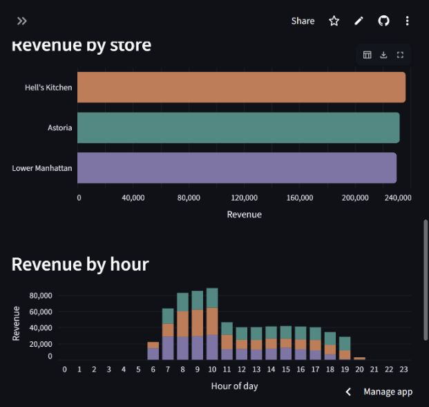

# Coffee shop analytics

A dbt + Snowflake portfolio project exploring coffee shop sales across three stores, with a portable Streamlit dashboard.

**[Open the interactive demo](https://whelixw-coffee-shop-sales.streamlit.app/)** · [Offline checks](https://github.com/whelixw/dbt-snowflake/actions/workflows/saved-demo.yml)

The public demo opens in Saved demo mode and needs no Snowflake login.



## Data and architecture

The full dataset covers 1 January–30 June 2023: **149,116 sales rows**, **214,470 units**, and **698,812.33 revenue**.

```text
coffee_shop_sales_full (CSV seed)
    └── stg_coffee_shop_sales (explicit types, trimmed text, calendar fields)
        ├── dim_products (80 products)
        ├── dim_stores (3 stores)
        └── fct_coffee_shop_sales (sales rows and revenue)
            ├── store_order_totals
            ├── store_order_totals_hours
            └── Streamlit: live query OR saved CSV snapshot
```

Staging lives in `models/staging`; dimensions, facts, and summaries live in `models/marts`. Dimensions describe products and stores; the sales fact keeps those attributes for straightforward dashboard filtering. The separate `orders` seed and `customer_order_totals` model are retained learning examples outside the coffee shop pipeline.

## Run the dashboard

From the repository root, with Python 3.10 or newer:

```powershell
python -m venv .venv
.venv\Scripts\python.exe -m pip install -r dashboard/requirements.txt
.venv\Scripts\python.exe -m streamlit run dashboard/app.py
```

The dashboard defaults to **Saved demo**, reading `dashboard/data/fct_coffee_shop_sales.csv`: actual results exported from the Snowflake dbt reporting model. This mode needs no credentials, database connection, or dbt installation and continues to work after the Snowflake trial expires. **Live Snowflake** queries the same reporting model using your local connection settings and a masked password plus authenticator code (`username_password_mfa`).

Features: store, category, and date filters; revenue, orders, units sold, and average order value; daily and hourly charts; store and category comparisons; top products; and filtered CSV downloads.

Revenue = quantity × unit price. Orders count source rows, matching `store_order_totals.sql`. Currency is unspecified. The snapshot covers January–June 2023 with 149,116 sales rows, 214,470 units, and 698,812.33 revenue. Both modes calculate dashboard summaries with pandas from the reporting model results. Snapshot provenance and verification totals are recorded in [dashboard/data/readme.md](dashboard/data/readme.md).

## Share a hosted demo from GitHub

GitHub stores the code and sample data; a Streamlit server runs the interactive app. GitHub Pages cannot run this Python app.

1. Push the repository to GitHub.
2. Sign in to [Streamlit Community Cloud](https://share.streamlit.io/) and create an app.
3. Select your repository and branch, with `dashboard/app.py` as the entrypoint.
4. Deploy and share the generated URL. Saved demo needs no Snowflake secrets. Live Snowflake additionally requires local or hosted connection settings; never commit credentials.

Community Cloud finds `dashboard/requirements.txt` beside the entrypoint, keeping dashboard dependencies separate from the root dbt dependencies. See the [deployment guide](https://docs.streamlit.io/deploy/streamlit-community-cloud/deploy-your-app/deploy).

## Run dbt with Snowflake

Install the root `requirements.txt`, configure your local dbt profile using `profiles.example.yml`, and set its `DBT_SNOWFLAKE_*` environment variables. Run:

```powershell
dbt seed
dbt run
dbt test
```

These commands require an active Snowflake account. Saved demo is independent of that pipeline. Live Snowflake reads `fct_coffee_shop_sales`, defined in `models/marts/fct_coffee_shop_sales.sql`. The full source dataset is `seeds/coffee_shop_sales_full.csv`. Keep connection settings in the ignored `.streamlit/secrets.toml`; password and authenticator code are entered in the app.


## Validation

The dbt tests check required values, unique sale and dimension IDs, valid calendar values, positive quantities, nonnegative prices, and sales references to product/store dimensions. The current models were built and validated in Snowflake on 21 October 2026.

The saved snapshot was exported and verified on 20 October 2026. It is a fixed historical export; later SQL cleanup does not automatically refresh it. See its provenance record for the export totals.

GitHub Actions runs the offline snapshot and dashboard checks without Snowflake credentials. Run the same checks locally after installing the dashboard dependencies:

```powershell
.venv\Scripts\python.exe -m unittest discover -s tests -p "test_*.py" -v
```

These checks protect the verified snapshot totals, revenue calculation, saved-mode isolation from Snowflake, filtering, reset, and source switching. Snowflake dbt tests run separately with an active account.

## Scope and limitations

- Orders and average order value use sales-row counts, not reconstructed customer baskets.
- Currency and customer identity are not supplied by the coffee shop dataset.
- Saved demo is a reproducible historical snapshot, not a live refresh pipeline.
- Live mode requires an active Snowflake account and configured connection settings. The public demo can run entirely in Saved demo without secrets.
- Model renames do not delete old Snowflake relations automatically.
